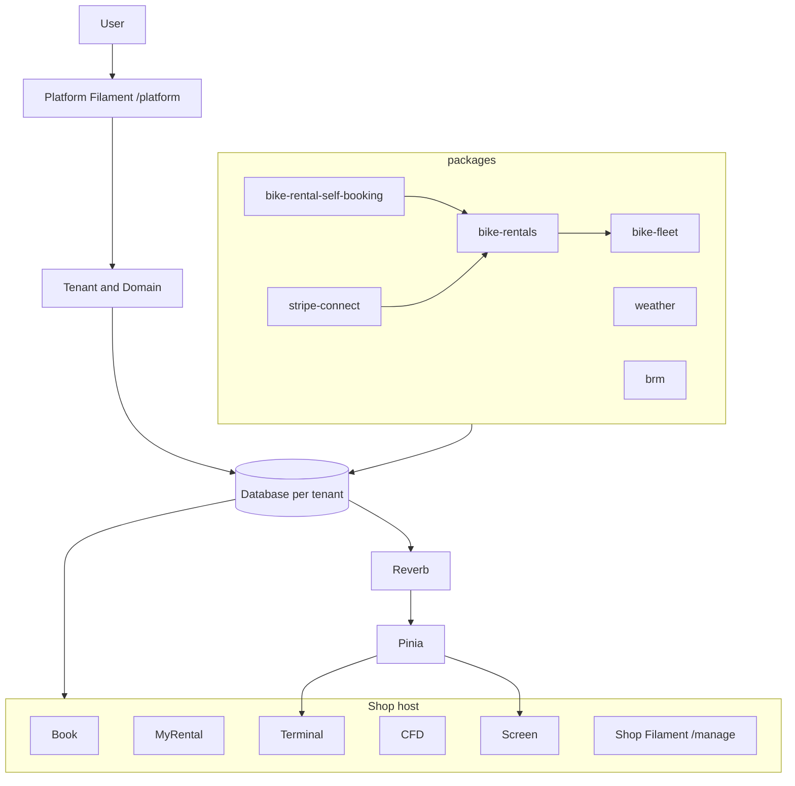

# Embiken

SaaS for independent bike rental shops. One **Tenant** is one shop operator, with its own database, identified by domain. A **Location** is a store in that database. v1 is one Location per Tenant.

This README is for engineers and agents working in the repo. Names live in [CONTEXT.md](CONTEXT.md). Product law lives in [.ai/guidelines/embiken.md](.ai/guidelines/embiken.md). Settled decisions that are easy to miss live in [docs/adr](docs/adr).

## Motivation

Embiken is the successor to embiken-brew. The rental domain is the same: a fleet, reservations as a party of bikes, packages, and the counter. This rebuild is multi-tenant SaaS, with a database per shop operator.

The desk has to stay live. Terminal, the shop board, and the customer display update as bikes and reservations move. Those screens keep their state in Pinia and receive server patches over Reverb, so a second display updates with the shop.

## AI configuration

[boost.json](boost.json) selects Codex, Cursor, and Claude Code, along with the Boost skills installed for them. Skills are copied under `.agents/skills`, `.cursor/skills`, and `.claude/skills`. The Laravel Cloud procedure also lives at [.ai/skills/deploying-laravel-cloud/SKILL.md](.ai/skills/deploying-laravel-cloud/SKILL.md).

| File | Role |
| --- | --- |
| [.ai/guidelines/embiken.md](.ai/guidelines/embiken.md) | Always-on product law. Edit this, then regenerate the agent files. |
| [AGENTS.md](AGENTS.md), [CLAUDE.md](CLAUDE.md) | Generated from the guidelines and the Boost rules. Leave them to `php artisan boost:update`. |
| [CONTEXT.md](CONTEXT.md) | Glossary: what a domain word means. |
| [.ai/rules/index.md](.ai/rules/index.md) | Path-scoped rules. Read the matching file before editing that path. |
| `.ai/rules/boost/` | Framework guidelines owned by Boost. Leave them to `boost:update`. |

`composer update` runs `boost:update`. To regenerate the agent files on their own:

```sh
php artisan boost:update
```

## Architecture

The host app owns Staff, Location, viewscreens, and the websocket channel. Shop domain lives in Composer path packages under `packages/*` (`embiken/*`). Each package is a tenant module that can be enabled per Tenant. Filament for a model stays in that model’s package.



Mutating use cases are [Laravel Actions](https://github.com/lorisleiva/laravel-actions). The Action is the HTTP endpoint and the Artisan command. Inertia renders the first paint. Mutations return JSON. Wayfinder generates the TypeScript route functions the Vue app calls.

Availability is the occupancy seam. Each bike line holds the reservation interval, inclusive, plus a turnaround buffer after the end. A quote does not write that hold.

Renters pay the shop through Stripe Connect Express. Book captures the package confirm amount immediately, with a 3% application fee to the platform. The reservation caches owed and paid. Transactions are the money history.

| Surface | Path | Who |
| --- | --- | --- |
| Book | `/book` | Customer, public until they reserve |
| MyRental | `/myrental` | That customer, for that reservation |
| Terminal | `/terminal` | Staff |
| CFD | `/cfd` | Paired customer display |
| Screen | `/screen` | Shop board |
| Shop Filament | `/manage` | Managers |
| Platform Filament | `/platform` on the central host | Platform Users |

`localhost` and `127.0.0.1` are the central hosts. `/` there redirects to `/platform`. Book, Terminal, and `/manage` are on the shop’s domain.

## Local

PHP 8.3 or newer (this repo is developed on PHP 8.5), Node.js, and npm. The default database is SQLite at `database/database.sqlite`. `composer setup` creates that file when it migrates.

```sh
composer setup
php artisan make:filament-user --panel=platform
composer run dev
```

`make:filament-user` asks for the name, email, and password. Pass `--name`, `--email`, and `--password` to skip the prompts.

Then open [http://localhost:8000](http://localhost:8000). That host is the central platform.

`composer run dev` starts the PHP server, the queue listener, Pail, Vite, and Reverb. Reverb’s local port is `8080`, from `.env.example`.

A shop is a Tenant with its own Domain. Creating one is done in Platform Filament after you are signed in. The shop’s Book, Terminal, and `/manage` URLs use that domain.

Checks, including Pint, PHPStan, and the test suite:

```sh
composer test
```

## Deploy

Production runs on Laravel Cloud. Install and authenticate the CLI, then ship:

```sh
composer global require laravel/cloud-cli
cloud auth -n
cloud ship -n
```

Later deploys:

```sh
cloud deploy -n
```

Pass the application and environment explicitly. Discover flags with `cloud ship -h` and `cloud deploy -h`. The full procedure, including databases, domains, secrets, and what to do when a command fails, is the [deploying-laravel-cloud](.ai/skills/deploying-laravel-cloud/SKILL.md) skill.

Local development uses SQLite. On Cloud, use a database server that can create one database per Tenant. Keep tokens and Stripe secrets in the Cloud environment.
